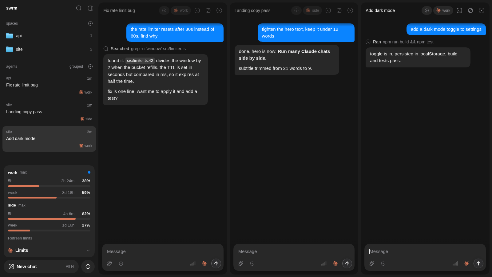
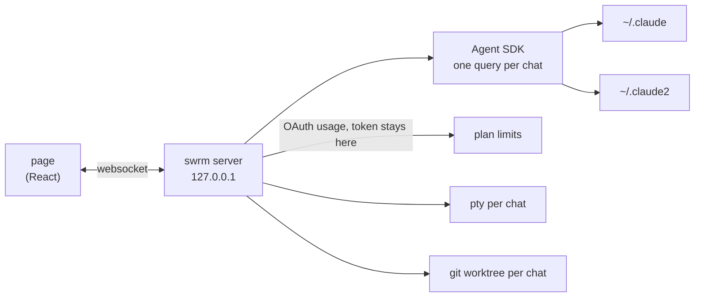

<div align="center">

<br>

# swrm

**Many Claude Code chats. One screen. Every account's limits in sight.**

A tiny local web cockpit on top of the Claude Agent SDK.<br>
Your skills, `CLAUDE.md`, MCP servers and settings load as usual.

<br>


<br>



<br>

</div>

## Why

One terminal per chat means tmux, two accounts and a guess at how much of the 5h window is left.
swrm puts up to six chats on one screen, runs each on the account you pick, and keeps the limits of every account on screen all the time.

## What you get

**Side by side**
Split up to six chats. Each chat is bound to its own Claude account, so a second plan does real work instead of sitting idle.

**Limits that stay visible**
5h, week and per-model windows for every account, with time to reset. You see a window running dry before it stops a chat.

**Real Claude Code, not a lookalike**
Every chat is the Agent SDK. Approvals, questions, tool calls and diffs arrive as cards instead of terminal text. "Always allow" writes the rule the CLI itself would write.

**Cheap when idle**
A chat nobody is talking to shuts its process down and resumes on the next message.

**A git workflow per chat**
Optional worktree for every chat, the working diff split by file (untracked files included), commit and push. It never force-pushes.

**A shell and a mention box**
A real pty in the chat's folder (its worktree when it has one), `@` to mention files, images and files dropped into the composer.

**Everything the agent runs in the background**
Subagents, background shells and monitors show up as a timeline on the tool call that started them. Connected MCP servers and the permission rules a chat loads are one click away.

**Your old sessions**
Sessions from `~/.claude*/projects` are listed and can be resumed as swrm chats.

## Run

```sh
npm install
npm run build
npm start        # opens http://127.0.0.1:4141
```

Needs Node 20+ and the `claude` CLI.

An account is a Claude Code config dir: `~/.claude`, `~/.claude2`, and so on. Log one in and it appears in swrm:

```sh
CLAUDE_CONFIG_DIR=~/.claude2 claude
```

### Own window

```sh
swrm app         # no browser chrome, starts the server in the background if needed
```

Uses a chromium-based browser (`SWRM_BROWSER`, or chromium, google-chrome-stable, brave).

### AppImage

```sh
sh scripts/appimage.sh    # release/swrm-x86_64.AppImage
```

A WebKitGTK shell of about 700 KB plus node and the server. The machine needs `webkit2gtk-4.1`, `gtk3` and the `claude` CLI.

## Config

Optional `~/.config/swrm/config.json`:

```json
{
  "port": 4141,
  "idleMinutes": 3,
  "defaultMode": "default",
  "accounts": [{ "id": "work", "name": "work", "dir": "~/.claude" }]
}
```

`SWRM_PORT` overrides the port. `XDG_CONFIG_HOME` and `XDG_DATA_HOME` move the config and the saved chats.

## Keys

| Key | Action |
|---|---|
| `alt n` | new chat |
| `alt shift n` | new chat in a split |
| `alt 1` to `alt 6` | focus a pane |
| `alt w` | close the pane |
| `alt b` | toggle the sidebar |
| `esc` in the composer | stop the turn |

## How it works



A chat starts Claude Code with `CLAUDE_CONFIG_DIR` pointed at its account. For limits, the server reads the account's OAuth token and asks the same usage endpoint Claude Code's `/usage` reads. The token never leaves the process, the page only gets percentages.

## Security

There is no login. The only protection is the address:

- the server listens on `127.0.0.1` only
- HTTP and websocket reject any `Host` or `Origin` that is not swrm itself, so a page open in another tab cannot drive it

The page drives agents that can run commands, so anyone who can reach the port has a shell as you. Do not expose it through a proxy or a tunnel, and think twice on a shared machine.

## Good to know

- Limits come from an endpoint Claude Code uses but Anthropic does not document. It can change or go away.
- A token that has expired is not refreshed by swrm. Run a chat on that account and Claude Code refreshes it.
- Tested on Linux only.
- swrm is not made by or affiliated with Anthropic.

## License

MIT, see [LICENSE](LICENSE).

## Credits

The look of the chat, the git flow and the terminal drawer follow [t3code](https://github.com/pingdotgg/t3code) by T3 Tools Inc. (MIT). Details in [THIRD_PARTY_NOTICE.md](THIRD_PARTY_NOTICE.md).
